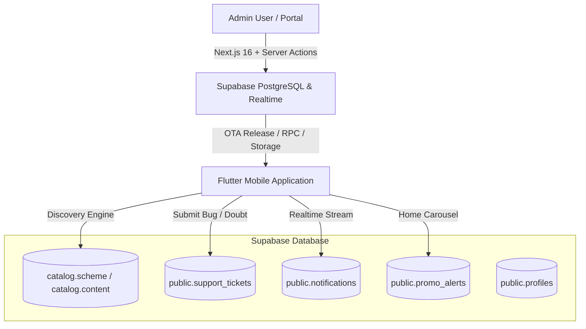

# 🏛️ IN Schemes — Admin Panel System Capabilities & Operations Guide

Welcome to the comprehensive reference guide for the **IN Schemes Administrative Portal**. This platform is a companion dashboard built with **Next.js 16 (App Router)**, **Turbopack**, **Tailwind CSS v4**, and **Supabase**, engineered to manage, monitor, and synchronize data with the **IN Schemes Multi-Platform Flutter Mobile Application**.

---

## 📑 Table of Contents
1. [System Architecture & Flutter Integration](#1-system-architecture--flutter-integration)
2. [Executive Dashboard (`/`)](#2-executive-dashboard-)
3. [Schemes Catalog Explorer (`/schemes`)](#3-schemes-catalog-explorer-schemes)
4. [Catalog v3.1 Scheme Drafting Wizard (`/schemes/new`)](#4-catalog-v31-scheme-drafting-wizard-schemesnew)
5. [Support Tickets & Bug Reports Hub (`/tickets`)](#5-support-tickets--bug-reports-hub-tickets)
6. [Mobile Announcements & Notification Dispatcher (`/notifications`)](#6-mobile-announcements--notification-dispatcher-notifications)
7. [Security, Roles & Data Resilience](#7-security-roles--data-resilience)
8. [Quick Operations Cheat Sheet](#8-quick-operations-cheat-sheet)

---

## 1. System Architecture & Flutter Integration

The Admin Panel operates as the central control plane for the IN Schemes ecosystem:

### Key Integration Points:
- **Canonical Schema Alignment (Catalog v3.1)**: Schemes drafted in the Admin Panel strictly conform to the reference skeleton (`SCH000124`) expected by the Flutter app's search engine, contract tests, and ranking models.
- **Trilingual Parity (PR #112)**: Native support for English (`en`), தமிழ் (`ta`), and हिन्दी (`hi`) synchronized to `catalog.content`.
- **Instant Mobile Feeds (PR #113)**: Push announcements into `public.notifications` stream in real-time to active mobile devices.
- **Home Carousel Alerts**: Directly update the top banner carousel of the Flutter app via `public.promo_alerts`.

---

## 2. Executive Dashboard (`/`)

The Dashboard is the operational landing page giving administrators an instant pulse of the platform:

### Key Features:
- **Live KPI Metric Cards**:
  - **Total Schemes**: Real-time count of all government schemes in the catalog.
  - **Active Published**: Schemes currently available to citizens and MSMEs on mobile.
  - **Drafts Pending**: Schemes submitted and awaiting publishing review.
  - **Open Bug Reports**: Live count of unresolved user tickets from `public.support_tickets`.
- **Recent Activity Feed**: Quick-access view of the 4 most recently updated schemes with status badges (`PUBLISHED` vs. `DRAFT`) and modification timestamps.
- **Direct Shortcuts**: Instant CTA to launch the Scheme Wizard or inspect open bug reports.

---

## 3. Schemes Catalog Explorer (`/schemes`)

A high-performance interactive table for searching, inspecting, and filtering government schemes:

### Key Features:
### Key Features:
- **Fast Client-Side Search**: Search across scheme names, official scheme codes (e.g. `MSME2526-099`, `MH-MSME2526-104`), and target states.
- **Category Filter**: Filter schemes by the 8 canonical MSME categories matching the Flutter app's `kSchemeTypeGroups`:
  - *Loans & Credit*
  - *Subsidies & Incentives*
  - *Grants & Seed Funding*
  - *Credit Guarantee*
  - *Skill Development & Training*
  - *Market Linkage & Export*
  - *Infrastructure & Technology*
  - *Special Welfare & Assistance*
- **Status Filter & Control**: Filter schemes by status (`ALL`, `PUBLISHED`, `DRAFT`, `DISABLED`).
- **One-Click Disable / Enable Action**: Instant toggle button to deactivate (`DISABLED`) or activate (`PUBLISHED`) schemes with live optimistic state updates.
- **Edit Scheme (`/schemes/[id]`)**: Full pre-populated 5-step wizard to modify live schemes, update financial subsidies, eligibility criteria, and localized texts.
- **Delete Scheme Confirmation Modal**: Safe deletion with associated audit logging.
- **Status Badges**: Visual indicators (`PUBLISHED` in emerald, `DRAFT` in amber, `DISABLED` in slate).
- **Pagination & Counter**: Clean navigation across large scheme registries with configurable page sizes.
- **Dual Data Retrieval**: Queries `mss_search_data` RPC with automated fallback to `catalog.scheme` to ensure zero blank-screen failures.

---

## 4. Catalog v3.1 Scheme Drafting Wizard (`/schemes/new` & `/schemes/[id]`)

A guided, 5-step form to author and edit government schemes that integrate seamlessly with the Flutter mobile app's recommendation engine:

### Step Breakdown:
1. **Step 1: General Info & Governance**:
   - **Maharashtra & State Auto-Assignment**:
     - Selecting **Maharashtra** (or any state) automatically generates official state-prefixed codes (e.g. `MH-MSME2526-XXX`), pre-fills the state nodal ministry (*Department of Industries, Government of Maharashtra*), sponsoring authority (*DI-MAHA*), implementing agency (*DIC Maharashtra / MSSIDC*), official portal (*https://industry.maharashtra.gov.in*), and sample title.
     - Central Scheme toggle: switching off pan-India automatically defaults to Maharashtra and triggers state auto-assignment.
     - **State Intelligence Badge**: Visual card displaying the state code prefix pill (`MH`), detected language (`मराठी - Marathi (mr)`), and a one-click *Re-Apply State Defaults* button.
     - **Scheme Code Auto-Generator**: Generates financial year MSME-compliant codes with 1 click (`RefreshCw`).
2. **Step 2: MSME Eligibility Rules**:
   - **Enterprise Scale Selector**: Target `Micro`, `Small`, and/or `Medium` enterprises with investment/turnover helper benchmarks.
   - **Target Demographics**: Multi-select tags (`Women`, `SC`, `ST`, `Differently-abled`, `Minority`, `Transgender`, `Ex-servicemen`, `General`).
   - **Eligibility Thresholds**: Min/max age boundaries, gender target, annual turnover cap (₹ INR), and investment cap (₹ INR).
3. **Step 3: Financial Assistance & Subsidies**:
   - Benefit Classification (Capital Subsidy, Term Loan, Working Capital, Credit Guarantee, Interest Subvention, Seed Grant, Margin Money, DBT).
   - Minimum and Maximum funding ceilings.
   - Subsidy Percentage (e.g., 15% – 35%).
   - Clear benefits narrative displayed on mobile scheme detail cards.
4. **Step 4: Trilingual Localization (English, தமிழ், हिन्दी / मराठी)**:
   - **State Target Language Banner**: Highlights the detected regional language for the state (e.g. Marathi `mr` for Maharashtra, Tamil `ta` for Tamil Nadu) with Devanagari script parity notices.
   - **Pre-fill State Templates**: 1-click button to auto-fill localized regional titles, summaries, and benefits text for Maharashtra, Tamil Nadu, and regional states.
   - Dedicated tabbed editor supporting **English**, **Tamil (`ta`)**, and **Hindi (`hi`)**.
   - Input localized Scheme Name, Summary, Detailed Description, and Benefits text.
   - Automatically populates `content.localization` and `catalog.content` rows.
5. **Step 5: Document Checklist & Live Mobile Card Preview**:
   - Interactive required documents manager (add/remove document tags).
   - **Live Mobile Card Preview**: Visual preview showing the scheme card styled exactly like the Flutter application card.
   - Validation & Submission to Supabase with SHA-256 integrity checksums.

---

## 5. Support Tickets & Bug Reports Hub (`/tickets`)

A real-time customer service and bug triage dashboard:

### Key Features:
- **Supabase Realtime WebSockets**:
  - Listens to PostgreSQL `INSERT`, `UPDATE`, and `DELETE` events on `public.support_tickets`.
  - Displays instant toast notifications when a mobile user submits a new ticket from their phone without requiring page reloads.
- **Triage & Status Resolution**:
  - Quickly toggle tickets between `open`, `in_progress`, `resolved`, and `closed`.
  - Optimistic UI updates with instant server persistence.
- **Category Filter**: Filter tickets by issue type (`Eligibility Matcher Bug`, `Wrong Scheme Details`, `Feature Request`, `General Inquiry`).
- **User Detail Inspection**: View user contact email, timestamp, and detailed problem narrative.

---

## 6. Mobile Announcements & Notification Dispatcher (`/notifications`)

Direct communication channel to engage mobile app users and highlight key schemes:

### Key Features:
- **Broadcast Notification Dispatcher**:
  - Push real-time messages to mobile users' in-app notification centers.
  - **Category Alignment**: `new_schemes` (New Scheme Alert), `reminders` (Deadline Reminder), `updates` (Policy/Subsidy Update), `profile` (Udyam Document Notice).
  - **Demographic Segmentation**: Broadcast to all registered users or filter by **State** and **Gender** (e.g., notify only Women entrepreneurs in Tamil Nadu).
  - **Interactive Mobile Preview**: Simulates the exact notification card rendered by the Flutter `NotificationItemDto` UI.
  - **Batch Insertion**: High-efficiency chunked insertions into `public.notifications`.
- **Home Carousel Promo Banner Manager**:
  - Dynamically controls the prominent promo banner carousel on the mobile app's Home screen (`public.promo_alerts`).
  - Configure banner title, badge pill text (e.g., `NEW SCHEME`, `CLOSING SOON`), action button label, and target in-app route (`schemes`, `notifications`, `categories`, `profile`).
  - One-click deletion and instant mobile sync.
- **Dispatch History Log**: Full historical record of previous broadcasts, category tags, recipient counts, and timestamps.

---

## 7. Security, Roles & Data Resilience

- **Service Role Bypass**: The admin portal uses `SUPABASE_SERVICE_ROLE_KEY` server-side to bypass Row Level Security (RLS) for catalog drafting and broadcast insertions.
- **RPC Hardening**: Aligns with Phase F Decision D7 (`REVOKE EXECUTE FROM public/anon; GRANT TO service_role`).
- **Resilient Fallback Design**:
  - Scheme creation calls `create_scheme_draft` RPC, with graceful automatic fallback to direct `catalog.scheme` table insert if RPC arguments differ.
  - Generates SHA-256 checksums (`sha256:...`) and records all operations in `admin.catalog_change_log`.
- **Navigation Progress Bar**: Custom top loading bar providing immediate feedback during server route transitions.

---

## 8. Quick Operations Cheat Sheet

| Task | Where to Go | How to Do It |
| :--- | :--- | :--- |
| **Draft a New Scheme** | `/schemes/new` | Fill in the 5 steps (Governance, Eligibility, Benefits, Localization, Documents) and click *Submit Scheme Draft*. |
| **Search Existing Schemes** | `/schemes` | Type scheme name, code, or state in the search bar, or select a category filter. |
| **Resolve a User Bug Report** | `/tickets` | Locate ticket, inspect problem details, and click the status dropdown to mark as *Resolved* or *Closed*. |
| **Send Push Alert to Users** | `/notifications` | Choose category, enter title and message, select target state/demographic, and click *Send Broadcast*. |
| **Add Home Banner Carousel** | `/notifications` | Click *Add Home Banner*, enter headline and badge text, pick target route, and click *Publish to Mobile Home*. |
| **Check Platform Health** | `/` | Review total schemes, active published, drafts pending, and open tickets on the dashboard. |

---

*Document compiled for IN Schemes (MSS App) Administration Platform.*
